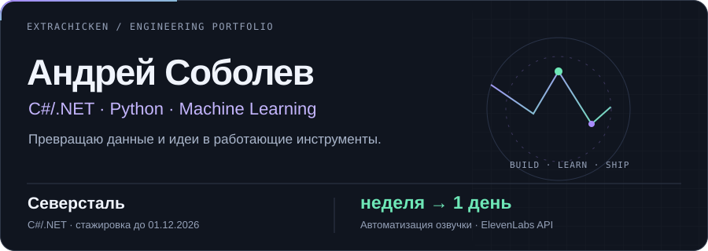
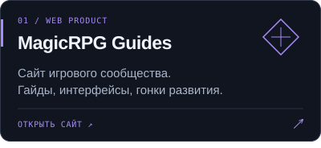
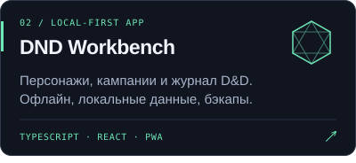
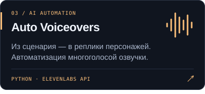
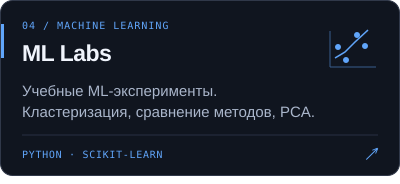

<picture>
  <source media="(max-width: 600px)" srcset="assets/profile-header-mobile.svg">
  
</picture>

  
  

  
  
  
  
  
  

<h3>Избранные проекты  / selected work</h3>

  
  

  
  

  <a href="https://github.com/extrachicken/auto-HR">AI для HR</a> &nbsp; · &nbsp;
  <a href="https://github.com/extrachicken/project-to-ai-context">Project → AI context</a> &nbsp; · &nbsp;
  <a href="https://github.com/extrachicken?tab=repositories">Все репозитории ↗</a>

<strong>Опыт работы</strong> — Северсталь / Самолов групп

<strong>Северсталь · C#/.NET-разработчик, стажировка</strong> 
Июль 2026 — настоящее время; окончание — 1 декабря 2026. 
ПО для взвешивания железнодорожных составов: обработка показаний оборудования,
алгоритмы распознавания типов вагонов, модели данных и интерфейс оператора.
C#/.NET, Avalonia, MVVM, проверка изменений.

<strong>Самолов групп · Саунд-дизайнер, автоматизация озвучки</strong> 
Март 2025 — май 2026. 
TTS-озвучка персонажей обучающих игр, настройка голосов и обработка звука.
Автоматизация через ElevenLabs API сократила подготовку озвучки
с недели до одного дня.

<strong>Стек и немного обо мне</strong>

<ul>
  <li><strong>Приложения:</strong> C#, .NET, Avalonia, ASP.NET Core, TypeScript, React.</li>
  <li><strong>Данные и ML:</strong> Python, pandas, NumPy, scikit-learn, PyTorch, Jupyter.</li>
  <li><strong>Хранение:</strong> SQL, PostgreSQL, EF Core, IndexedDB.</li>
  <li><strong>Автоматизация:</strong> REST API, LLM, TTS, n8n, PowerShell.</li>
  <li><strong>Разработка:</strong> Git, Docker, GitHub Actions, xUnit, Vitest.</li>
</ul>

ЧГУ · прикладная математика и информатика, «Искусственный интеллект». 
Английский — C1. Вне кода — музыка, игры и настольные RPG.

<strong>GitHub в цифрах</strong>

Статистика публичных репозиториев; рабочие и закрытые проекты сюда не входят.

